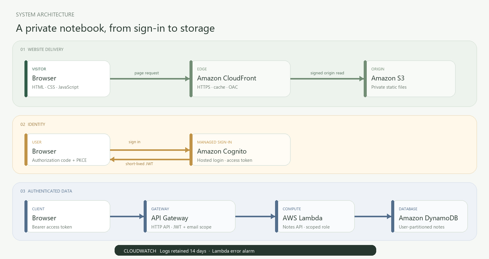
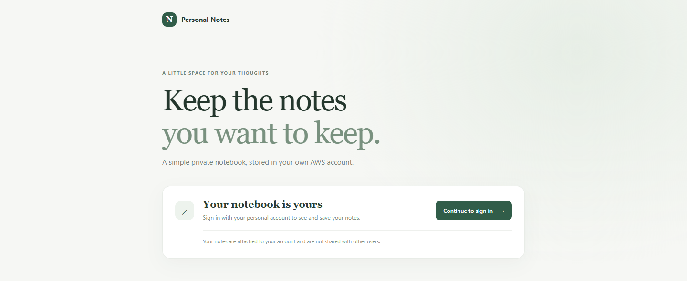
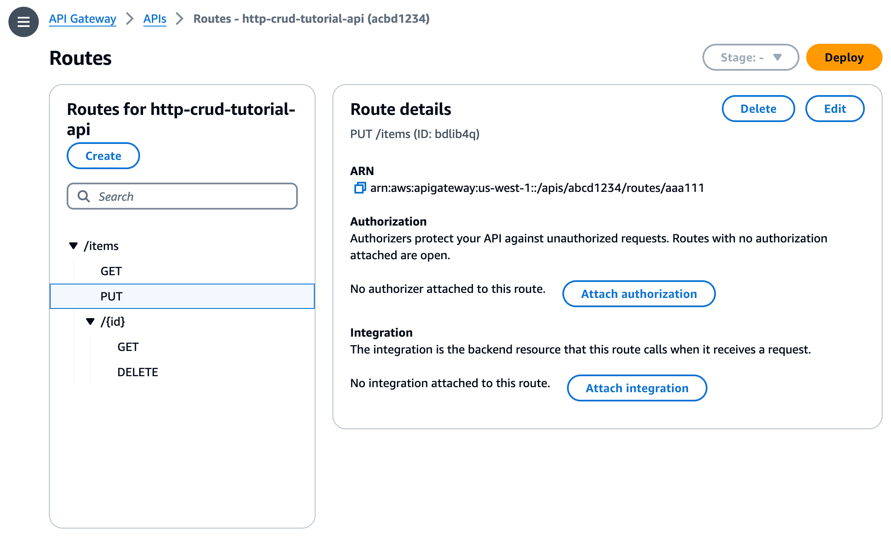

# Personal Notes on AWS

A small serverless notes app for one person or a small private user pool. The static UI is delivered through CloudFront from a private S3 bucket. Amazon Cognito signs users in; API Gateway checks JWTs; Lambda reads and writes only the signed-in user's DynamoDB partition.

## Architecture



The browser receives the static application through CloudFront, then signs in with Cognito. It sends a short-lived access token with its API requests. API Gateway validates the token and scope before Lambda reads or writes notes in DynamoDB.

The SAM template provisions the app's AWS resources. The frontend is uploaded separately after stack deployment. The S3 origin is private and restricted to its CloudFront distribution with Origin Access Control. DynamoDB uses on-demand billing. API routes require a valid Cognito access token, and the Lambda scopes every database operation to the token's `sub` claim.

## Prerequisites

- An AWS account with billing alerts enabled and permission to create the resources in `template.yaml`.
- AWS CLI v2 and AWS SAM CLI installed and configured for a personal sandbox account.
- Node.js 20 or newer for local static serving (no build step is required).
- A globally unique Cognito hosted-domain prefix.

## Deploy

1. From the repository root, run `sam build`.
2. Run `sam deploy --guided`. Choose a stack name such as `personal-notes`, a region, and a unique `CognitoDomainPrefix`. Keep the generated S3 bucket private. Review the change set before confirming.
3. Copy the stack outputs `SiteBucketName`, `CloudFrontDomainName`, `UserPoolId`, `UserPoolClientId`, `CognitoIssuer`, and `ApiUrl`.
4. In Amazon Cognito, open the created app client. Add `https://<CloudFrontDomainName>/` to its allowed callback URLs and sign-out URLs. Save. The template includes localhost callback URLs for local development.
5. Copy `app/config.example.js` to `app/config.js`, then set the outputs. `config.js` is git-ignored so identifiers for a live stack do not get committed.
6. Upload the static site and invalidate CloudFront:

   ```powershell
   .\scripts\publish.ps1 -BucketName <SiteBucketName> -DistributionId <CloudFrontDistributionId>
   ```

   The distribution ID is available in the CloudFront console; the domain name alone is not the ID.
7. Visit the CloudFront URL, create your first Cognito user, confirm the email, and sign in. Add a test note, refresh, and delete it to confirm the flow.

For local development, copy and configure `app/config.js`, then run `npx serve app` and use `http://localhost:3000/` (or another port that you also add to the Cognito callback and sign-out URLs). The API's CORS configuration allows browser requests; authorization still depends on a valid token.

## Screenshots

The browser screenshot below is the actual signed-out screen rendered from this repository. It contains no account data.



The API Gateway console image is an AWS documentation example, not a screenshot of this stack. Its sample route has no authorizer attached; this project requires a Cognito JWT authorizer and the `email` scope on every note route. See the [console walkthrough](docs/aws-console-walkthrough.md) for the account-specific screens to capture after you deploy.



## Security notes

- Do not commit `app/config.js`, AWS credentials, tokens, or real personal notes.
- Cognito sign-up is enabled for this learning project. Disable public sign-up after creating your own account if nobody else should register.
- The API's `GET`, `POST`, and `DELETE` routes use a Cognito JWT authorizer and require the `email` scope. A user can read and change only records whose partition key equals their own Cognito `sub`.
- Lambda has table-scoped `GetItem`, `PutItem`, `Query`, and `DeleteItem` permissions. The frontend has no AWS credentials.
- The static bucket blocks public access. CloudFront OAC grants read access to that one distribution; viewers use HTTPS.
- This is a personal learning deployment, not a compliance-ready production system. Set a budget alert, use MFA on the AWS account, and avoid storing highly sensitive information.

## Monitoring and cost

Lambda logs are retained for 14 days and an alarm watches for function errors. DynamoDB is on-demand and the app has no always-running compute. CloudFront, API Gateway, Cognito, Lambda, DynamoDB, S3 storage/requests, logs, and alarms can still incur charges. Actual cost depends on region and use; check the AWS Pricing Calculator and billing console before deploying. Delete the CloudFormation stack when finished, then check for retained or separately uploaded S3 objects and remove them if no longer needed.

## Repository map

- `template.yaml` - SAM/CloudFormation resources and permissions.
- `src/handler.mjs` - authenticated note API.
- `app/` - browser UI and Cognito authorization-code-with-PKCE flow.
- `scripts/publish.ps1` - upload static assets and invalidate CloudFront.
- `docs/aws-console-walkthrough.md` - step-by-step deployment and screenshot checklist.
- `docs/Serverless_AWS_Project_Guide_Final.docx` - Word walkthrough.

## License

Personal project. Add a license if you plan to share or publish the repository.
