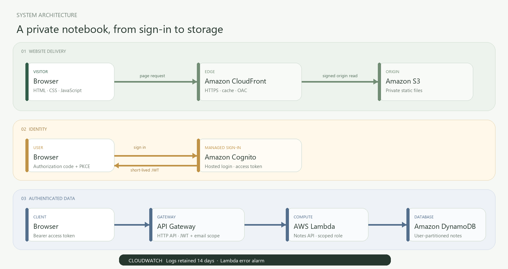
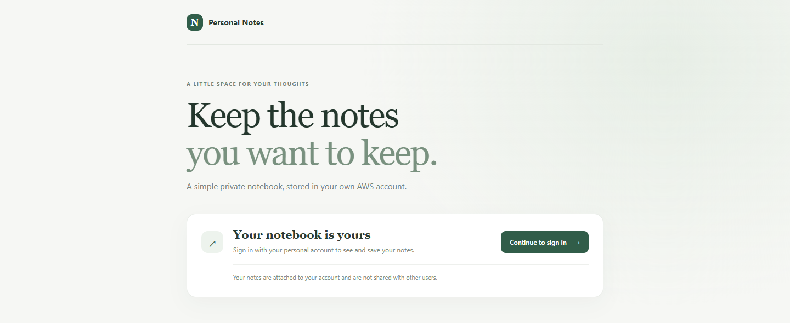
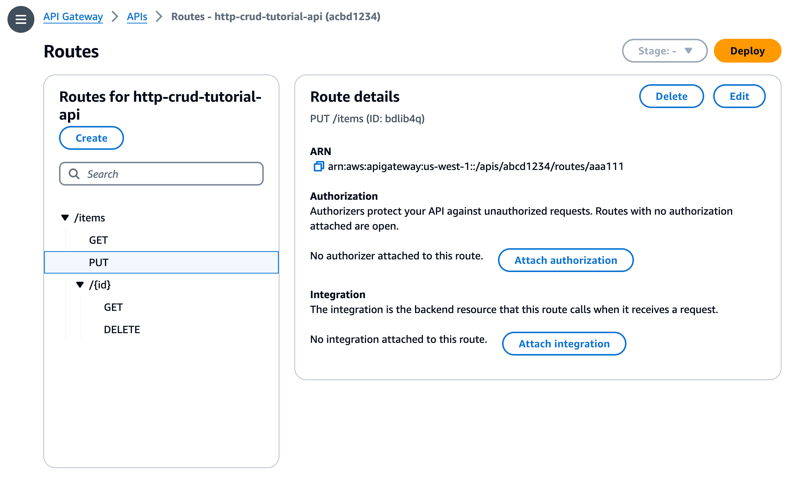

# AWS console walkthrough

This guide pairs with `template.yaml`. It creates a small personal app stack with CloudFormation through AWS SAM. Read the change set before deployment. Resource names in the console include the stack name, and the Cognito domain prefix must be globally unique.

The browser sign-in screen in the repository is shown below. It is captured from the local project files; a live account is needed to complete sign-in and show saved notes.

## Before opening the console

1. Sign in to the AWS console with an account you control. Turn on multi-factor authentication and create a billing budget or alert.
2. Install AWS CLI v2 and AWS SAM CLI. Configure the CLI for the same account and region that you intend to use in the console.
3. In PowerShell, move to the repository root and run `sam build`, then `sam deploy --guided`.
4. Select a short stack name and region. For `CognitoDomainPrefix`, try a unique lowercase name with numbers if the first choice is unavailable.
5. At the change-set prompt, review the resources and permissions, then approve the deployment. It can take several minutes for CloudFront to finish deploying.

## Console steps and what each screen means

### 1. CloudFormation stack

In the AWS console search box, open **CloudFormation**, choose **Stacks**, then select your stack. On **Events**, wait for `CREATE_COMPLETE`. On **Outputs**, note `ApiUrl`, `SiteBucketName`, `CloudFrontDomainName`, `CloudFrontDistributionId`, `UserPoolId`, `UserPoolClientId`, `CognitoIssuer`, and `CognitoDomain`.

The stack is the deployment record. Its template keeps the services and access rules together so the setup can be reviewed and removed as one unit.

### 2. Cognito callback URLs

Open **Amazon Cognito** → **User pools** → the pool ending in `-users` → **App integration** → the app client `personal-notes-web`. Edit the callback and sign-out URL lists. Add the exact URL `https://<CloudFrontDomainName>/` to both lists and keep localhost entries if you use local development. Save.

The Cognito hosted page signs the user in. The browser completes an authorization-code flow with PKCE, then sends its short-lived access token to API Gateway. The app client has no client secret because it runs in a browser.

### 3. CloudFront and the private S3 origin

Open **CloudFront** → **Distributions** → the distribution ID from stack outputs. Confirm the distribution is enabled and deployed. Open its **Origins** tab and confirm the origin points to the stack's S3 bucket and uses Origin Access Control. Open **Amazon S3** → the site bucket → **Permissions** and confirm Block Public Access is on. Opening an object through its direct S3 URL should not serve the page; use the CloudFront domain instead.

CloudFront serves the static UI over HTTPS. The bucket policy permits read access to this distribution only, so the S3 origin is not a public website endpoint.

### 4. API Gateway and the JWT authorizer

Open **API Gateway** → **APIs** and choose the HTTP API created by the stack. Under **Routes**, inspect `GET /notes`, `POST /notes`, and `DELETE /notes/{id}`. Each route uses the Cognito JWT authorizer. The browser's CORS configuration permits requests from a web page; CORS alone is not authentication.

The screenshot is a navigation reference from AWS's official CRUD tutorial. It is not this project's deployed API, and its selected example route has no authorizer. For this project, verify that all three routes have the JWT authorizer and the `email` scope.

API Gateway rejects missing or invalid tokens before Lambda runs and checks the `email` authorization scope so an ID token cannot be substituted for an access token. Use the app UI to exercise routes after signing in rather than pasting a live token into a screenshot.

### 5. Lambda and its execution role

Open **Lambda** → **Functions** → the function named in the stack output `FunctionName`. On **Configuration** → **Permissions**, open the execution role. Inspect its inline policy: it should grant only `GetItem`, `PutItem`, `Query`, and `DeleteItem` on the notes table ARN. It does not grant access to every DynamoDB table.

The Lambda handler reads the verified `sub` claim from API Gateway's authorizer context. It uses that value as the DynamoDB partition key, so one signed-in user cannot ask the API to select another user's partition.

### 6. DynamoDB table

Open **DynamoDB** → **Tables** → the table ending in `-notestable` (or the generated stack resource name). Under **Overview**, inspect the `userId` partition key and `noteId` sort key. Under **Additional settings**, confirm on-demand capacity. The template enables server-side encryption and leaves point-in-time recovery off to avoid a recurring backup charge in this small practice deployment.

After adding a sample note through the app, the table shows a user partition and note item. Do not use real sensitive content in a practice account.

### 7. Logs and alarms

Open **CloudWatch** → **Logs** → **Log groups**, then find `/aws/lambda/<function name>`. Log retention is 14 days. Open **Alarms** and find the Lambda errors alarm. It changes to `ALARM` if the function reports an error in a five-minute period; it does not automatically send a notification. Add an SNS action only if you want email or mobile alerts.

### 8. Test and clean up

Open the CloudFront URL, create and verify your Cognito account, then sign in. Save a non-sensitive test note, refresh, and delete it. Confirm that signing out hides the notebook. Once the project is no longer needed, delete the CloudFormation stack. Because the site bucket can contain uploaded objects, empty it if CloudFormation reports that the bucket is not empty, then retry stack deletion. Check Billing and Cost Management afterward for remaining charges or resources.

## Real screenshot checklist

Capture each image from your own signed-in AWS console after deployment. Use the Windows snipping shortcut, crop out account IDs, email addresses, browser profile details, and any tokens. Store screenshots in a private folder; add only sanitized images to a public repository.

1. CloudFormation **Outputs** showing stack outputs (hide account-specific or identifying values if publishing).
2. CloudFront distribution **Origins** showing the S3 origin and OAC.
3. S3 bucket **Permissions** showing public access blocked.
4. API Gateway **Routes** and authorizer settings.
5. Lambda **Permissions** showing the table-scoped role.
6. DynamoDB table **Overview** showing the keys and capacity mode; do not show note contents.
7. CloudWatch **Log group** retention and **Alarm** state.
8. The running app in the browser with sample text only.

The screenshots above are capture instructions, not fabricated AWS console images. CloudFormation resource IDs, URLs, account details, and states only exist after deployment in your AWS account.
